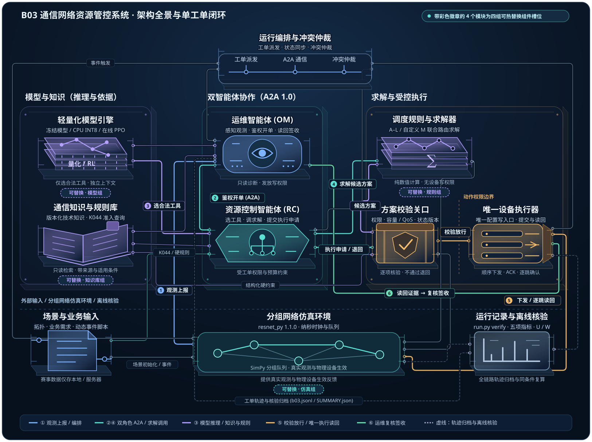

# B03 通信网络资源管控系统（20 节点）

> 本仓库为 **20 节点** 分组仿真协作基线（与另一规模共用同一套组件接口和评测闭环）。  
> 核心导航：[四组协作约定](docs/COLLABORATION_zh.md) · [实测基线与指标](docs/RELEASE_RESULTS.md) · [完整对接与评分指南](docs/JOINT_OPTIMIZATION.md)

---

## 一、30 秒看懂系统怎么跑



> 💡 **交互式流程演示**：克隆仓库后，用浏览器直接打开 [docs/flow_demo.html](docs/flow_demo.html) 即可单步播放“一张工单如何走完闭环”及“四组改哪里”（脱敏单文件，无需联网或装依赖）。

系统由 **运维智能体（OM）** 和 **资源控制智能体（RC）** 协作，围绕一张工单走完 5 步闭环：

1. **感知与开单（OM）**：分组仿真器推进网络事件，探针经真实网络队列将状态上报给 OM；OM 只读诊断后开立工单，明确**可写业务范围、保护名单与状态版本**。
2. **协议交接（A2A 1.0）**：OM 通过 A2A 协议将工单和当前观测快照交给 RC。
3. **决策与求解（RC → 模型 / 知识库 / 规则库）**：RC 用固定策略或模型在合法目录内选定一个工具，按需查询只读技术知识（如 `K044` 准入核查），再调用规则求解器算出具体路径与带宽分配。
4. **校验与唯一写入（关口 → 执行器）**：校验关口独立检查权限、共享容量、原始 QoS 和状态版本；通过后由**唯一设备执行器**顺序下发，并做**逐跳读回**确认真实生效。
5. **签收与复算（OM → 离线核验）**：读回证据交回 OM 复核签收；完整轨迹落盘后，用 `run.py verify` 离线复算五项赛题指标和 `U / W`。

**统一对照原则**：固定规则（如 `--policy I`）和模型推理（`--policy model`）走完全同一套工单、校验、写入和读回链路，保证各组改进都能在同条件下公平对比。

---

## 二、按小组快速找入口

| 小组 | 你负责替换的部分 | 配置示例（基于 `config/components.json`） | 接口细则文档 |
|---|---|---|---|
| **模型组** | `choose(observation)` 在合法目录内选工具；支持冻结推理、CPU INT8 量化与在线训练恢复 | `config/example-model.json`<br>`config/int8-model.json` | [模型接口 docs/MODEL.md](docs/MODEL.md) |
| **规则组** | `enumerate_actions` 与 `solve_action` 路径与共享容量求解（无设备写权限） | `config/example-rules.json`<br>`config/branch-rules.json` | [规则接口 docs/RULES.md](docs/RULES.md) |
| **知识库组** | 版本化只读技术知识库与检索器 `lookup(identifier/topic)` | `config/knowledge-v2.json`<br>`config/example-knowledge.json` | [知识接口 docs/KNOWLEDGE.md](docs/KNOWLEDGE.md) |
| **仿真组** | `b03.packet-simulator.v1` 兼容仿真适配器或引擎版本锁 | `config/example-simulator.json` | [仿真接口 docs/SIMULATOR.md](docs/SIMULATOR.md) |
| **系统集成组** | OM/RC、A2A、权限目录、方案校验、唯一写入、五指标核验与发版合入 | `config/components.json` | [联调与评分 docs/JOINT_OPTIMIZATION.md](docs/JOINT_OPTIMIZATION.md) |

> **⚠️ 关于“可替换”的客观边界**  
> 只要遵循接口契约，就能通过 `--components config/xxx.json` 热替换自家组件，无需改动主控和评测链路。  
> 但这**不代表任意改动模块都能零成本无缝衔接**：例如当前冻结参考模型只见过既有动作目录里的分配算法；若规则组新增了模型从未见过的新算法工具，可以先用 `--policy <新工具号>` 独立测算法收益，若希望模型学会调用它，则需要登记新动作目录并由模型组配合重新训练对齐。

---

## 三、5 分钟跑通最小闭环

需要 **Python 3.12** 和赛事方分发的官方场景包。分组仿真引擎 **resnet_py 1.1.0** 的源码已内置于 `simulator/resnet_py/`，设置 `B03_DATA` 即可运行。`B03_SIMULATOR` 可选，用于指定外部引擎。详见[资产与路径说明](docs/ASSETS.md)。

```bash
# 1. 指向本地官方数据目录
export B03_DATA=/path/to/b03-data
export PYTHONDONTWRITEBYTECODE=1

# 2. 创建环境并安装基础依赖
python3.12 -m venv .venv
source .venv/bin/activate
python -m pip install -r requirements.txt

# 3. 跑通默认工单并离线核验（每次请使用新的输出目录）
python run.py run --output runs/first
python run.py verify runs/first --report runs/first-check.json
```

- **本仓默认配置**：对应官方场景 `data/scenarios/sce20261010-conf02/sce01/`、默认脚本 **`09`**（3 条授权业务、固定工具 `I`、残余准入）；默认参考权重为 **`v18（动作映射 A–C）`**。全量业务可加 `--services all`，更多参数见 `python run.py run --help`。
- **训练入口说明**：20 节点训练请调用 `src/packet_training.py:run_episode` 采集并核验工单后接入自家优化器；仓库内置的 `train.py step` 参考训练器仅面向 100 节点 `v374` 与脚本 `04/05`。
- **源码单测**：运行 `python -B -m unittest discover -s tests`（60 项回归测试）。

**进阶用法按需查阅**（不在首页堆命令）：
- 切换各组插件、跑独立规则 `M` 或对比五项指标 → [docs/JOINT_OPTIMIZATION.md](docs/JOINT_OPTIMIZATION.md)
- 跑冻结模型、CPU 动态 INT8 或在线 PPO 恢复 → [docs/MODEL.md](docs/MODEL.md)
- 导出真实组件 I/O 样例（`run.py examples`）与严格依赖溯源（`--strict-source`） → [docs/PROVENANCE.md](docs/PROVENANCE.md)
- 查看当前验收实测数据与已知边界 → [docs/RELEASE_RESULTS.md](docs/RELEASE_RESULTS.md)

---

## 四、目录速览与协作红线

```text
├── run.py / train.py       # 统一运行、核验、知识查询、样例导出与训练入口
├── config/                 # 默认组件清单 (components.json) 及各组替换示例配置
├── src/                    # OM/RC、A2A、唯一设备执行、逐跳读回与各组件适配器实现
├── simulator/              # 分组网络仿真引擎 resnet_py 纯源码（不含官方数据包）
├── knowledge/              # 可公开的版本化技术知识 JSON（不含赛事原始数据）
├── docs/                   # 架构图、交互流程演示页及四组详细接口文档
└── tests/                  # 60 项源码与契约回归测试
```

**三点协作约定**：
1. **分支开发**：从 `main` 切自己分支，通过 `config/` 扩展配置切换自家组件；**每次对比尽量只换 1 个组件**。
2. **PR 交付物**：附上配置差异、复现命令，以及同条件下的 `run.py verify` 对照表（动作、U/W、耗时、设备生效与读回数）。
3. **保密红线**：**赛事原始数据（拓扑、业务、脚本和原包自带的官方场景目录）、大体积模型权重及含场景明细的运行日志仅限本地或授权服务器使用。**

<details>
<summary>关键核心源码文件直达（供系统集成与联调查阅）</summary>

- [OM / RC 角色与工单鉴权](src/packet/packet_roles.py)
- [A2A 1.0 通信传输](src/packet/packet_a2a.py)
- [唯一设备写入执行](src/packet/packet_device.py)
- [逐跳配置读回](src/packet/packet_device_readback.py)
- [分组与业务指标统计](src/packet/packet_measure.py)

</details>
